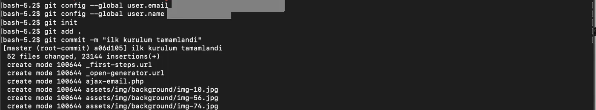
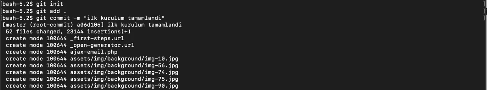
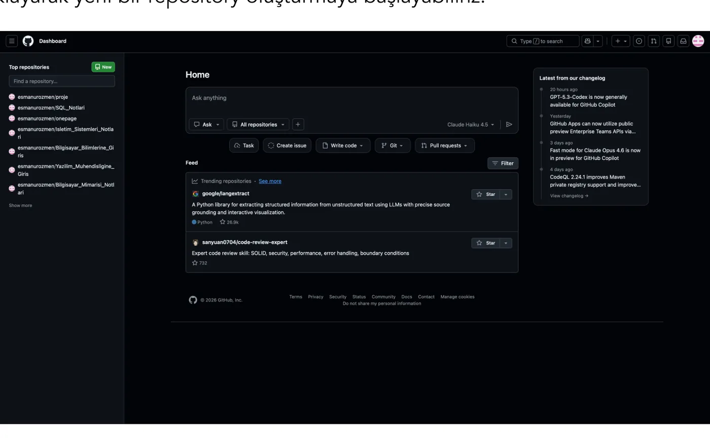
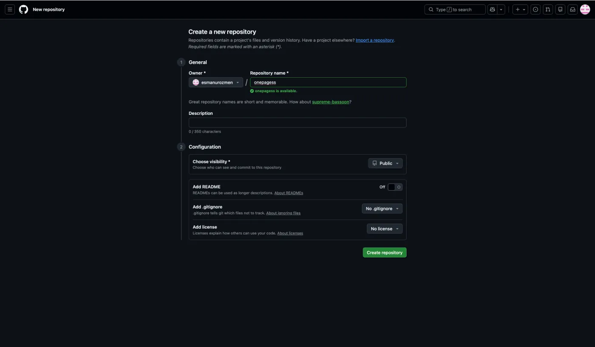
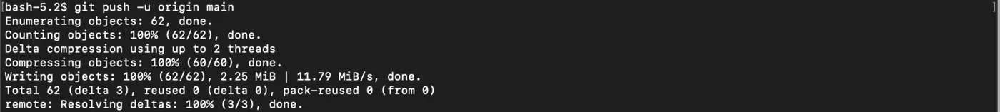
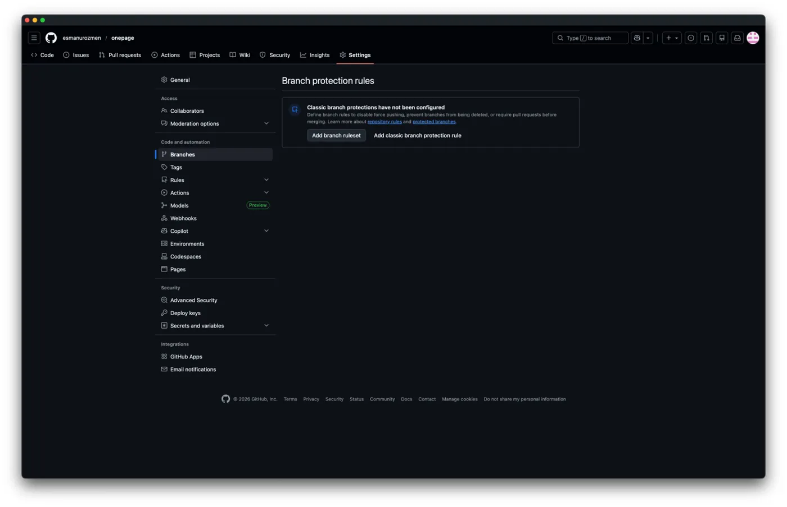
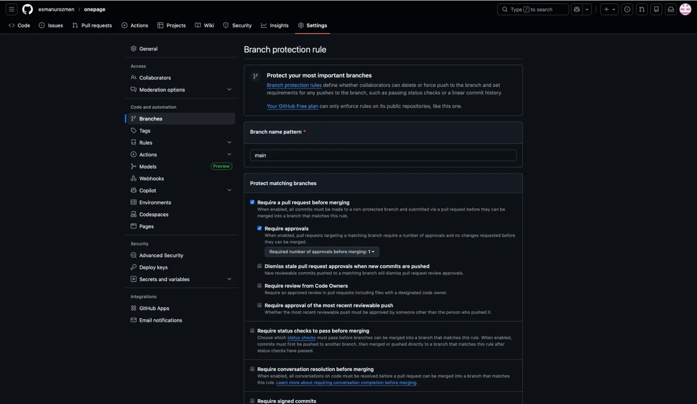
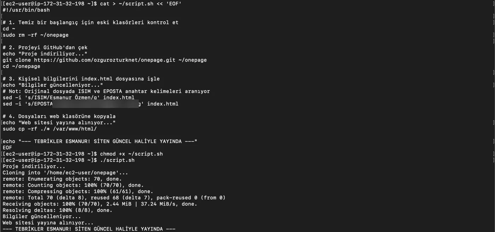

Web sitemizi ve onu host edeceğimiz GitHub altyapısını oluşturarak devam edelim.

## Görev 11: Site dosyalarını indirme

> 11-) https://github.com/aytitech/public/raw/main/sayfa.tgz dosyasını indirin ve açın.

## Git initialization

> onepage klasörüne girin ve git initialization gerçekleştirin.

Bu işlem için öncelikle sisteme kendimizi tanıtmamız gerekiyor bunun için `--global user.email "mail_adresi"` ve `--global user.name "kullanıcı_adınız"` komutlarını kullanıyoruz ardından sırasıyla `git init`, `git add .` ve `git commit -m "commit_satırı"` komutlarını çalıştırırız.

:::caution[Düzeltme]
Kullanıcı bilgileri `git config` komutuyla verilir: `git config --global user.email "mail_adresi"` ve `git config --global user.name "kullanıcı_adınız"`.
:::





```bash frame="terminal"
git config --global user.email "**********@*****.com"
git config --global user.name "Ad Soyad"
git init
git add .
git commit -m "ilk kurulum tamamlandi"
```

```text title="Çıktı"
[master (root-commit) a06d105] ilk kurulum tamamlandi
 52 files changed, 23144 insertions(+)
 create mode 100644 _first-steps.url
 create mode 100644 _open-generator.url
 create mode 100644 ajax-email.php
 create mode 100644 assets/img/background/img-10.jpg
 create mode 100644 assets/img/background/img-56.jpg
 create mode 100644 assets/img/background/img-74.jpg
 create mode 100644 assets/img/background/img-75.jpg
 create mode 100644 assets/img/background/img-90.jpg
...
```

## GitHub reposu oluşturma

> Ardından github üzerinde onepage adında public bir github reposu oluşturun. README.md dosyası olmasın içinde.

1. GitHub hesabımıza bağlandıktan sonra sol üstte bulunan **New** butonuna tıklayarak yeni bir repository oluşturmaya başlayabiliriz.

   

2. Repo'muza isim verip bizden istendiği üzere README dosyasını **Off** şeklinde bırakıyoruz ve **Create repository** diyoruz.

   

## Projeyi repoya gönderme

> Bu git initialization yaptığınız projeyi yeni oluşturduğunuz repo'ya gönderin.

İşlemi gerçekleştirmek için kullanmamız gereken komut `git push -u origin main` olacaktır.



```bash frame="terminal"
git push -u origin main
```

```text title="Çıktı"
Enumerating objects: 62, done.
Counting objects: 100% (62/62), done.
Delta compression using up to 2 threads
Compressing objects: 100% (60/60), done.
Writing objects: 100% (62/62), 2.25 MiB | 11.79 MiB/s, done.
Total 62 (delta 3), reused 0 (delta 0), pack-reused 0 (from 0)
remote: Resolving deltas: 100% (3/3), done.
```

## main branch koruması

> Github repo'nuzun main branch'ını koruma altına alın ve 1 kişi review etmeden main branch'a merge işlemi gerçekleşemesin.

1. Oluşturduğumuz repoya tıkladıktan sonra **Settings** menüsüne gelerek solda bulunan **Branches** seçeneğini seçiyoruz.
2. Daha sonra **Add classic branch protection rule** diyerek devam ediyoruz.

   

3. Açılan ekranda aşağıda görüldüğü gibi boşluğu doldurup ilk iki seçeneği seçerek işlemimizi tamamlıyoruz.

   

## Yayına alma scripti

Sunucu hazır, web sitemiz hazır. O zaman bunu sunucuya yükleyelim de herkes görebilsin. Hatta tüm süreci otomatize çalışacak hale getirelim.

> Bir script yazın.
>
> Bu script sunucunuzda çalıştırıldığı zaman
>
> İlk olarak `git clone` ile onepage github reposunu `/tmp` folder'ına clonelasın. "Bu işlem sadece ilk defa indireceğiniz zaman ya da makine kapatılıp açıldığında işe yarayacaktır. Çünkü makine kapanıp açıldığında tmp folder'ı temizlenir. Bu nedenle script önce bu folder var mı diye baksın. Folder yoksa `git clone` çalışsın. Varsa çalışmasın" Scripte devam edin ve bu onepage folder'ına girerek remote repository'deki değişiklikleri locale çekin. Ardından `index.html` dosyasının içindeki `ISIM` kelimesini kendi isminizle, `EPOSTA` değerini de kendi eposta adresinizle değiştirin. Ve son olarak onepage folder'ının içindeki tüm dosyaları `/var/www/html` folder'ına kopyalayın. Eğer bu folder'da aynı isimli dosyalar varsa bunların üzerine yazsın.

Yazmamız gereken script aşağıdaki gibi olmalıdır. Scriptin içinde bulunan isim ve eposta kısımlarını kendi bilgilerimizle değiştirmeyi unutmayalım.



```bash frame="terminal"
cat > ~/script.sh << 'EOF'
#!/usr/bin/bash

# 1. Temiz bir başlangıç için eski klasörleri kontrol et
cd ~
sudo rm -rf ~/onepage

# 2. Projeyi GitHub'dan çek
echo "Proje indiriliyor..."
git clone https://github.com/ozgurozturknet/onepage.git ~/onepage
cd ~/onepage

# 3. Kişisel bilgilerini index.html dosyasına işle
echo "Bilgiler güncelleniyor..."
# Not: Orijinal dosyada ISIM ve EPOSTA anahtar kelimeleri aranıyor
sed -i 's/ISIM/Ad Soyad/g' index.html
sed -i 's/EPOSTA/**********@*****.com/g' index.html

# 4. Dosyaları web klasörüne kopyala
echo "Web sitesi yayına alınıyor..."
sudo cp -rf ./* /var/www/html/

echo "--- Site güncel haliyle yayında ---"
EOF
```

```bash frame="terminal"
chmod +x ~/script.sh
./script.sh
```

```text title="Çıktı"
Proje indiriliyor...
Cloning into '/home/ec2-user/onepage'...
remote: Enumerating objects: 70, done.
remote: Counting objects: 100% (70/70), done.
remote: Compressing objects: 100% (61/61), done.
remote: Total 70 (delta 8), reused 68 (delta 7), pack-reused 0 (from 0)
Receiving objects: 100% (70/70), 2.44 MiB | 37.24 MiB/s, done.
Resolving deltas: 100% (8/8), done.
Bilgiler güncelleniyor...
Web sitesi yayına alınıyor...
--- Site güncel haliyle yayında ---
```

:::caution[Düzeltme]
Bu script görevin bazı maddelerini karşılamaz: repoyu `/tmp` yerine `~/onepage` klasörüne indirir, klasörün varlığını kontrol edip `git pull` yapmak yerine her çalıştırmada klasörü silip baştan `git clone` yapar. Görevdeki davranış için örneğin `[ -d /tmp/onepage ] || git clone <repo_url> /tmp/onepage` ve ardından `cd /tmp/onepage && git pull` kullanılabilir. `git clone` adresi de kendi oluşturduğunuz onepage reposu olmalıdır.
:::

### 1. Script dosyasını oluşturma

- `cat > ~/script.sh << 'EOF'`: Bu komut, Şu andan itibaren yazdığım her şeyi `EOF` görene kadar `script.sh` isimli bir dosyanın içine kaydet anlamına gelir.
- `#!/usr/bin/bash`: Bu satır (Shebang), sisteme bu dosyanın bir Bash senaryosu olduğunu ve o dille okunması gerektiğini söyler.

### 2. Script içindeki adımlar (otomasyon)

- `cd ~`: Kullanıcının ana dizinine git demektir.
- `sudo rm -rf ~/onepage`: Eğer varsa, eski proje klasörünü zorla sil anlamına gelir. Bu işlem, her seferinde temiz bir başlangıç yapmamızı sağlar.
- `echo "..."`: Terminale bilgi mesajı yazdırır; script çalışırken ne aşamada olduğunu anlamamıza yardımcı olur.
- `git clone https://...`: Belirttiğimiz GitHub reposunu sunucuna indirir.
- `cd ~/onepage`: Yeni indirilen proje klasörünün içine girer.
- `sed -i 's/ISIM/Ad Soyad/g' index.html`: `index.html` dosyasını açar, içindeki `ISIM` kelimesini bulur ve yazdığımız isimle değiştirir.
- `sed -i 's/EPOSTA/.../g' index.html`: Aynı işlemi e-posta adresin için yapar.
- `sudo cp -rf ./* /var/www/html/`: Hazırladığın tüm dosyaları web sunucusunun yayın yaptığı klasöre kopyalar. `-f` parametresi, mevcut dosyaların üzerine sormadan yazılmasını sağlar.

### 3. Script'i devreye alma

- `chmod +x ~/script.sh`: Bu en kritik adım! Dosyaya "çalıştırılabilirlik" yetkisi verir. Bu komut olmadan script'in sadece bir metin dosyası olarak kalır.
- `./script.sh`: Yazdığın tüm bu senaryoyu tek seferde başlatır. Çıktılarda gördüğümüz "Cloning into...", "Bilgiler güncelleniyor..." yazıları bu komutun sonucudur.

## Sonuç

Son adımla birlikte, artık sanal makinemizin public IP adresini tarayıcımıza girdiğimizde web sayfamızın artık canlıda olduğunu göreceğiz. Böylece bulut ve devops'a giriş için güzel bir temel atıp önümüzdeki uzun yolculukta işimize yarayacak bilgileri yanımıza almış olduk.

Artık sıradaki öğreneceğimiz konu olan AWS'ye geçebiliriz. Ancak isterseniz direkt olarak AWS ile ilgili teknik detaylara girmeden önce gelin [bulut bilişimin tarihine](/bulut-temelleri/sunucudan-buluta/) neden böyle bir alana ihtiyaç duyulduğuna ve konuyu daha iyi anlamak adına gerekli bazı teorik bilgilerle beraber bazı konseptlere göz atalım.
